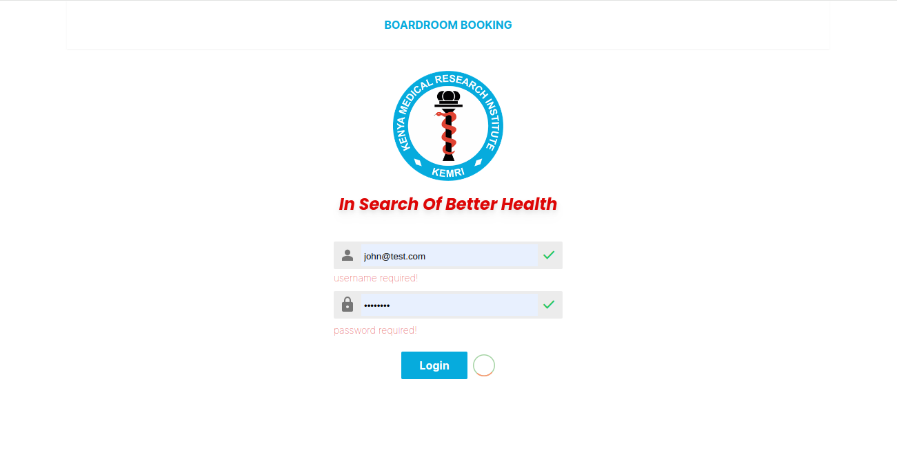
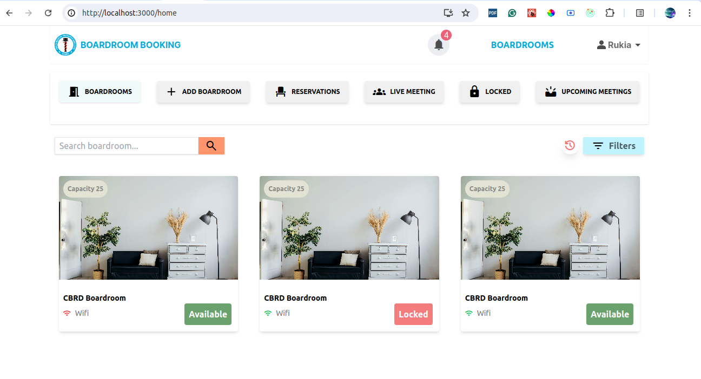
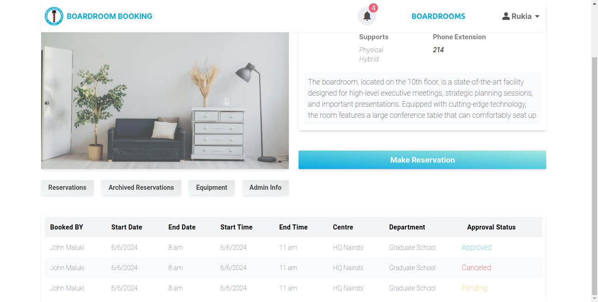
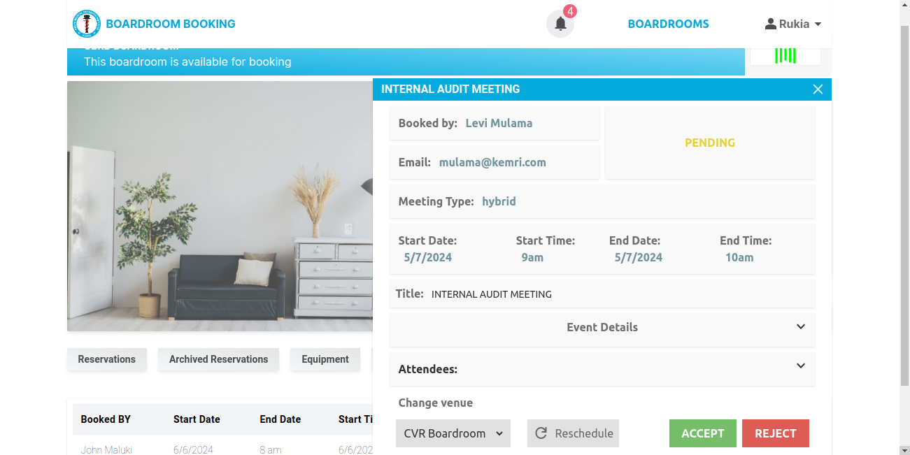

# KEMRI BOARDROOM BOOKING APP

## Overview

The app offers a streamlined solution for booking meeting rooms at [KEMRI](https://www.kemri.go.ke/) centers.

### Current Solutions and Future Developments

- The app integrates with Active Directory for user authentication.
- It offers features for reservation approval and rescheduling.
- The user interface is designed for ease of use.
- Additionally, notifications are enabled via email and within the app.
- The app tracks all equipment in each boardroom.


## Architecture

The backend is fully reactive, non-blocking from the HTTP layer down to the database.

- **Spring WebFlux on Netty** — every endpoint returns `Mono`/`Flux`, so list responses stream
  rather than being buffered.
- **R2DBC** for data access. R2DBC has no associations, so read paths select the joined shape
  they need in one query instead of lazily loading relations. The schema itself is plain SQL
  under `src/main/resources/tables/`, run automatically on startup (`CREATE TABLE IF NOT
  EXISTS`, so it only creates what's missing) rather than through Flyway or `ddl-auto`.
- **Redis** for read-through caching of reference data, and as the pub/sub channel that fans
  notifications out to every instance's SSE subscribers.
- **RabbitMQ** carries in-app notifications and outbound email off the request path, each with a
  dead-letter queue for messages that cannot be processed.
- **Server-Sent Events** at `GET /notifications/stream` deliver live notifications, replacing the
  previous STOMP-over-WebSocket broker. Traffic there only ever flows server to client, so SSE
  rides plain HTTP, works through proxies unchanged, and the browser reconnects on its own.

## Requirements

For building and running the application you need:

- [Java 17](https://www.oracle.com/java/technologies/javase/jdk17-archive-downloads.html)
- [Spring Boot 4.2](https://spring.io/projects/spring-boot) (Gradle 8.14+, supplied by the wrapper)
- PostgreSQL, Redis and RabbitMQ — all three are in `docker-compose.yml`
- A `.env` file (or the equivalent real environment variables) providing at least
  `POSTGRES_DB_URL`, `POSTGRES_DB_USER`, `POSTGRES_DB_PASSWORD` and `JWT_SECRET_KEY`

## Running locally

```bash
docker compose up -d      # postgres, redis, rabbitmq
./gradlew bootRun         # creates the schema if missing, seeds sample data (dev profile)
```

The schema is created automatically on startup from `src/main/resources/tables/*.sql` — see
`src/main/resources/tables/README.md`. Set `app.datasource.schema-init.enabled=false` to turn
that off and manage the schema by hand instead.

API docs are at `/swagger-ui.html`; RabbitMQ's management UI is at http://localhost:15672.

Schema changes: add or edit a `.sql` file under `src/main/resources/tables/`. There is no
Flyway and no `ddl-auto`, so nothing tracks what has already run beyond each file's own
`CREATE TABLE IF NOT EXISTS` — altering an existing table (adding a column, say) still needs
its own `ALTER TABLE`, run by hand once against databases that already have that table.

## Screenshots of the project

- Login Page
  
- Homepage
  
- Boardroom Detail Page
  
  - Details Page with Approval Popup
  

## Acknowledgements
We would like to express our gratitude to the open-source community and all the developers whose libraries and tools have made this project possible.
Thank you for using this app! We hope it helps you on your journey to a successful.

## Copyright

Released under the **Apache License 2.0** License. See the [LICENSE](https://github.com/john-maluki/boardroom-booking-backend/blob/main/LICENSE) file.